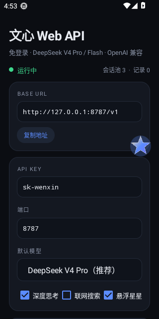
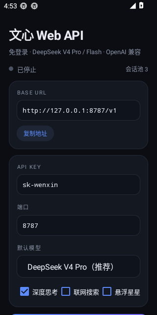

# 文心 Web API（wenxin-web-api）

把**百度文心助手手机版网页**（`wenxin.baidu.com`，**免登录**）里的 **DeepSeek-V4 Pro / DeepSeek-V4 Flash** 逆向成 **OpenAI 兼容 API**，并打包成可常驻后台的 Android APK。

> 纯 HTTP 直连，不依赖浏览器 / WebView 自动化；一个 APK 就是一台小 API 服务器。

**下载**：[WenxinWebApi.apk](https://github.com/Hiweny/wenxin-web-api/releases/latest/download/WenxinWebApi.apk)（约 120 KB）

<p align="center">
  
  
</p>

---

## 更新日志

### v1.4.1
- 工具调用提示加强（涉及实时/外部数据必须先调工具），e2e 命中率稳定 3/3。
- 历史里单条消息做上限（用户 1000 / 助手 1200 字符），避免一条长回答挤掉其他上下文。

### v1.4.0
- **上下文预算**：文心是单轮接口，塞太长的 prompt 会答非所问甚至被拒（实测长 prompt 会回「😩抱歉，出了点小问题，请稍后重试」）。现在按 7000 字符预算裁剪：系统指令 → 工具定义 → **从最近往前**的历史 → 当前问题；被丢弃的历史会标注条数，超长问题做头尾截断。可用 `context_chars` 调整。
- **prompt 结构重写**：分【系统指令】【可用工具】【对话历史】【当前问题】【回答要求】，结尾明确要求"只回答当前问题、不要复述历史"，解决"全量发送后回复重点跑偏"。
- **工具定义精简**：不再塞完整 JSON Schema，只给名字 + 一句话说明 + 参数名与类型，prompt 从 3500+ 字降到 200 字级，工具链不再因超长而断。
- **上游「软拒绝」识别**：HTTP 200 但正文是固定错误文案时判定为失败并自动换身份重试，不再把报错当回答传给客户端。
- **识图修复**：`http(s)` 图片先下载内联成 `data:`URL 再发给上游（外链常被防盗链/超时导致"模型看不到图"），单图上限 1.2MB，失败会明确记日志。
- **模型映射纠正**：实测上游只接受 `DeepSeek-V4` / `DeepSeek-V4-Flash` / `ERINE-5.1` / `smartMode`，其它值（如 `DeepSeek-R1`、`DeepSeek-V4-Pro`）会被**静默回退成文心助手**（质量明显更差）。现已全部收敛，模型列表同步为 `deepseek-v4`、`deepseek-v4-flash`、`ernie-5.1`、`smartmode`。
- 新增客户端自检日志：若两次请求的 messages 完全相同，会提示"前端没把新消息发出来"。

### v1.3.2
- 模型下拉文案缩短并自定义 13sp 字号，窄屏不再截断。
- 身份池容量默认提到 4，旧配置自动迁移。
- 复选框文案精简，减少换行。

### v1.3.1
- 修复补货线程 `notifyAll()` 未限定对象的致命 bug（`IllegalMonitorStateException`）——之前身份池永远是空的，每次请求都要现场预热，这是「明明网络很快却首字很慢」的直接原因。
- 思考链改为立即下发（不再等正文首段缓冲），正文首段判定阈值 36→24 字。
- 复用预热连接时给「等响应头」加 4s 短超时，预连接有效期 8s，避免复用被对端关闭的连接而白等十几秒。
- 模型下拉框文案缩短，避免窄屏截断；日志区与提示文字提高对比度；悬浮图标加极淡圆底 + 细描边，深浅壁纸下都清晰。

### v1.3.0
- **修复「不管问什么都回同一句」**：预热请求加 `Cache-Control: no-cache` + 随机 cache-buster，杜绝中间层缓存首页导致多次预热拿到同一个 `lid`（同一 lid = 上游视为同一页面会话 → 永远续写同一句）；身份池新增重复 `lid` 检测，重复则自动重新预热。
- **新增「重复回答守卫」**：若本轮问题已变化、但回答开头与上一轮完全相同，判定为上游会话串扰 → 自动换新身份重试（流式场景会在首段 36 字内判定，不污染客户端）。
- **速度**：上游 SSE 读取改为 16KB 缓冲流（原来逐字节 `read()` 每次都要一次 TLS 解密 + JNI，手机端慢 10 倍以上）；预热阶段预建到 `chat.baidu.com` 的 TLS 连接并 keep-alive 复用，省掉一次握手；身份池改双线程并发预热（容量 4）。
- **日志区不再卡顿/闪烁/自己乱跳**：从「每 700ms 全量重绘」改为增量 append + 120ms 节流；手指按在日志上时禁止外层 ScrollView 抢事件（解决「滑不动」）；上滑自动暂停吸底，回到底部恢复跟随。
- **应用名改为「文心API」**，图标用上传素材重制（传统 + 自适应双套），悬浮图标直接用同一枚图案的透明版（不再是五角星），点按打开 / 长按隐藏 / 拖动贴边。
- **前台通知显示调用状态**：正在思考 / 输出中（字数 + 秒数）/ 就绪（上次耗时）/ 失败，500ms 节流更新。
- **防撤回增强**：撤回时保留完整原文并记录 `withdraw` 标记，存档同时保存思考链，详情页可查看「撤回前原文」。
- UI 重新排版：品牌区、状态卡、参数卡、日志卡分区，圆角与间距统一。


---

## 特性

| 能力 | 说明 |
| --- | --- |
| 免登录 | 每次调用只需一次 `GET https://wenxin.baidu.com/` 预热，拿到匿名身份（cookie + token + lid），无需任何账号 |
| 模型 | `deepseek-v4-pro`、`deepseek-v4-flash`、`deepseek-r1`、`ernie-5.1`、`smartmode` |
| 深度思考 | **默认开启**，思考链以 `reasoning_content` 流式输出；`thinking:false` / `reasoning_effort:"none"` 可关 |
| 联网搜索 | **默认关闭**，`search:true` 开启（走文心对话接口自带的联网能力） |
| 识图 | 支持 `image_url`（http(s) 或 `data:` base64），实测可直接被上游识别，最多 4 张 |
| OpenAI 兼容 | `POST /v1/chat/completions`（流式 / 非流式）、`GET /v1/models`、`GET /v1/history`、`GET /healthz` |
| 工具调用 | 无原生 function calling → 用 `@@tool_calls@@` 标记协议 + 宽容解析，对客户端表现为标准 `tool_calls` |
| 防撤回 | 流式即时下发 + 本地完整存档（`/v1/history`、App 内「防撤回记录」），上游中途截断/撤回不影响已输出内容 |
| 可诊断 | `/debug/probe`（一次完整上游调用）、`/debug/last`（最近一次请求的原始 messages 与折叠后的 prompt） |
| 严格无状态 | **每个请求用一个全新匿名身份，用完即弃**（预取池只负责提速），彻底避免上游把同一 lid 当会话续写导致"永远回同一句" |
| APK 保活 | 前台服务 + WakeLock + 通知栏常驻 + 可选悬浮球 + 电池优化白名单引导 |
| 深色 UI | 单页极简控制台：状态、地址、Key、端口、模型、日志、记录 |

---

## 逆向出来的协议（2026-10 实测）

```
1) GET https://wenxin.baidu.com/   (手机 UA)
   → HTML 内嵌 <script type="application/json" name="aiTabFrameBaseData">
     { "token": "8hex", "lid": "19位数字", ... }        ← 匿名身份
   → 同时下发 cookie: BAIDUID / H_WISE_SIDS / BA_HECTOR / ZFY

2) POST https://chat.baidu.com/aichat/api/conversation
   body.message.searchInfo.chatParams.chat_token
       = base64( token | md5(query) | nowMs | lid ) + "-" + lid + "-3"
   header  x-chat-message:
       query:<urlencoded>,anti_ext:{"inputT":1500},enter_type:chat_url,
       re_rank:1,modelName:<DeepSeek-V4|DeepSeek-V4-Flash|...>,sa:bkb
   其它必带 header: source: wise_csaitab / isDeepseek: 1 / Origin / Referer

3) 响应 text/event-stream：
   event: basedata   → 会话信息（lid / baiduid）
   event: ping
   event: message    → 增量
       正文：data.message.content.generator.component 以 markdown 开头，
             文本在 generator.data.value（**增量**，直接拼接）
       思考：generator.data.reasoningContentArr[0]（全量）
       模型：generator.data.usedModel / speedInfo.labels.modelName
       用量：metaData.speedInfo.costs.promptTokenLabel / completionTokenLabel
       结束：metaData.state == "generate-complete" && endTurn == true
```

要点：`token`、`lid` 来自**首页 HTML**，`chat_token` 里的 md5 必须与 query 严格一致，
所以整套流程可以完全脱离浏览器（本仓库的 `WenxinSession` 就是纯 `HttpURLConnection` 实现）。

---

## 快速开始

### 方式一：装 APK（推荐）

1. 下载 Release 里的 `app-release.apk` 安装；
2. 打开 App → 设置端口（默认 8787）与 API Key（默认 `sk-wenxin`）→ **启动服务**；
3. 同一 Wi-Fi 下，客户端填 `http://<手机IP>:8787/v1`，Key 填你设置的字符串。

App 内有「防撤回记录」可查看本地完整存档；通知栏可一键停止；开启「悬浮球」后可随时点回 App。

### 方式二：纯 JVM 跑（调试用）

```bash
javac -encoding UTF-8 -d /tmp/wx \
  $(find app/src/main/java/com/hiweny/wenxinapi/core app/src/main/java/com/hiweny/wenxinapi/server -name '*.java') \
  tools/JvmServerMain.java
java -cp /tmp/wx com.hiweny.wenxinapi.JvmServerMain 8787
```

### 调用示例

```bash
curl http://127.0.0.1:8787/v1/chat/completions \
  -H 'Content-Type: application/json' -H 'Authorization: Bearer sk-wenxin' \
  -d '{"model":"deepseek-v4-pro","messages":[{"role":"user","content":"你好"}]}'
```

```python
from openai import OpenAI
client = OpenAI(base_url="http://127.0.0.1:8787/v1", api_key="sk-wenxin")

for chunk in client.chat.completions.create(
        model="deepseek-v4-flash",
        messages=[{"role": "user", "content": "用一句话介绍杭州"}],
        stream=True):
    print(chunk.choices[0].delta.content or "", end="")
```

工具调用：

```python
resp = client.chat.completions.create(
    model="deepseek-v4-pro",
    messages=[{"role": "user", "content": "查一下杭州天气"}],
    tools=[{"type": "function", "function": {
        "name": "get_weather",
        "description": "查询城市天气",
        "parameters": {"type": "object", "properties": {"city": {"type": "string"}}, "required": ["city"]}}}],
)
print(resp.choices[0].message.tool_calls)
```

---

## 请求参数（OpenAI 兼容之外的扩展）

| 参数 | 位置 | 默认 | 说明 |
| --- | --- | --- | --- |
| `thinking` | body / `extra_body` | `true` | 深度思考开关 |
| `reasoning_effort` | body / `extra_body` | — | `"none"` 关闭思考，其余视为开启 |
| `search` | body / `extra_body` | `false` | 联网搜索开关 |
| `messages[].content[]` | 标准 OpenAI 多模态 | — | `{"type":"image_url","image_url":{"url":"..."}}` 支持 `data:` URL |

> 无状态设计：不保存任何会话，客户端每次必须发送完整 `messages`；服务端会把它折叠成
> 「系统指令 + 对话历史 + 当前问题」一次性发给上游，因此**多轮上下文完全由客户端控制**。

## 端点

| 方法 | 路径 | 说明 |
| --- | --- | --- |
| POST | `/v1/chat/completions` | 主接口，支持 `stream`、`tools`、`extra_body.search=true`（联网搜索） |
| GET | `/v1/models` | 模型列表 |
| GET | `/v1/history?limit=50&full=1` | 防撤回存档（`id` 参数可看单条全文） |
| GET | `/v1/pool` | 会话池状态 |
| GET | `/healthz` | 存活探针 |
| GET | `/debug/probe` | 自检：真实跑一次上游调用并返回细节 |
| GET | `/debug/last` | 最近一次请求的原始 messages / 折叠后 prompt（排查"答非所问"最快） |

---

## 一个必须知道的坑：HttpURLConnection 在 Android 上会改写请求

同样的代码在 JVM 上跑得通、装到手机上却被上游判定为非法请求（只回 `😩抱歉，出了点小问题`）。
原因是 Android 的 `HttpURLConnection` 实现会：

* 合并 `Set-Cookie`（多个 cookie 变成一行，导致 cookie 解析残缺）；
* 丢弃值为空的请求头（`landingpageswitch: ""`）；
* 强制 `gzip` 并覆盖 `Accept-Encoding`。

所以本项目的网络层是**手写的 HTTP/1.1 客户端**（`core/Http1Client.java`：`SSLSocket` + SNI +
chunked 解码 + 原始 `Set-Cookie` 逐条解析），JVM 与 Android 的行为完全一致，也便于精确控制每一个字节。

---

## 设计说明

* **为什么不走浏览器**：网页端同样走这套 HTTP + SSE，浏览器只是外壳。直连省内存、省电、可并发，也不会因为页面改版而整块失效（改版时只需更新 `WenxinSession`）。
* **限流规避**：`SessionPool` 默认 3 个匿名身份，请求按轮询分配；同一身份串行；上游返回 `tokenFail` / 空回答时自动换身份重试一次；高频失败会重建身份（重新预热）。
* **防撤回**：分两层。① 流式边生成边下发，客户端已收到的内容永不回滚（上游若中途"缩短/重写"，`showType=replace` 且更短的片段会被忽略，只记 `withdraw` 标记）；② 完整回答落本地 `history.jsonl`，即使 App 重启也能查。
* **工具协议**：文心会把 `<...>` 类标签当 HTML 过滤，所以协议标记用 `@@tool_calls@@ ... @@end@@`；解析器同时兼容 `<tool_calls>`、```json 围栏、裸 JSON 数组等写法。

---

## 端到端验收

```bash
python3 tools/e2e_api.py http://127.0.0.1:8787 sk-wenxin
```

会依次验证：健康检查 → **三次独立提问答案互不相同**（防"永远回同一句"）→ 上下文全量传递 →
深度思考 → 关闭思考 → 识图（红/蓝）→ 工具调用 → 工具结果回传 → 联网开关 → 防撤回存档。
CI 的 `ui-shot` job 会把 APK 装进 Android 13 模拟器后跑同一份脚本。

## 目录

```
app/src/main/java/com/hiweny/wenxinapi/
├── core/                  # 与平台无关，可在纯 JVM 跑单测
│   ├── WenxinSession.java # 预热 + 对话（协议核心）
│   ├── SessionPool.java   # 匿名身份池 / 轮换 / 重建
│   ├── PromptBuilder.java # OpenAI messages → 文心 prompt（含工具协议注入）
│   ├── ToolBridge.java    # 工具调用解析 + 流式防泄漏闸门
│   ├── Json.java / Tools.java / Config.java / HistoryStore.java
├── server/
│   ├── HttpServer.java    # 极简 HTTP/1.1（chunked，SSE）
│   └── ApiRouter.java     # OpenAI 兼容路由
├── ApiService.java        # 前台服务（保活）
├── FloatingBubble.java    # 悬浮星星（拖动后自动贴边）
└── MainActivity.java      # 深色控制台
tools/                     # CI 冒烟测试入口（真实接口）
```

---

## 免责声明

仅供个人学习与研究。请遵守百度相关服务条款，不要用于商业或大规模滥用场景。
本项目不含任何账号凭据，所有请求均为匿名身份，行为与你自己打开网页对话一致。
